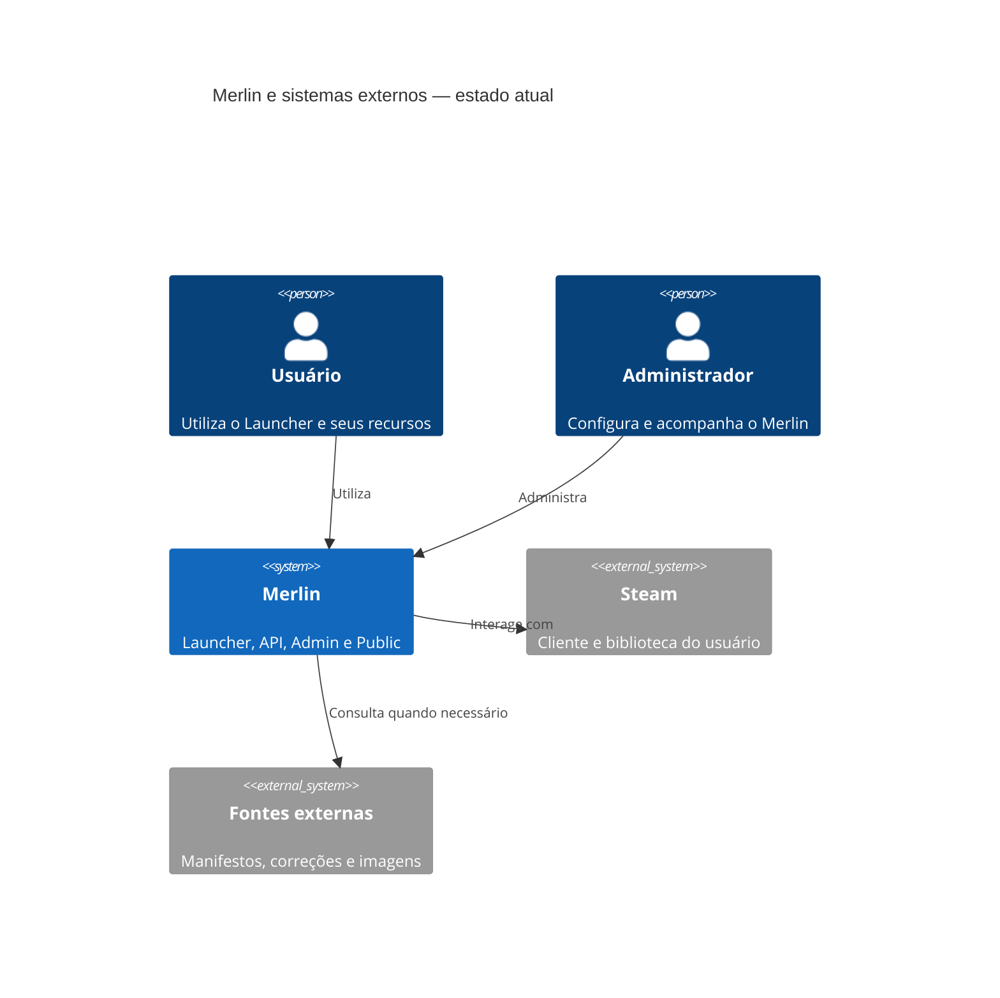
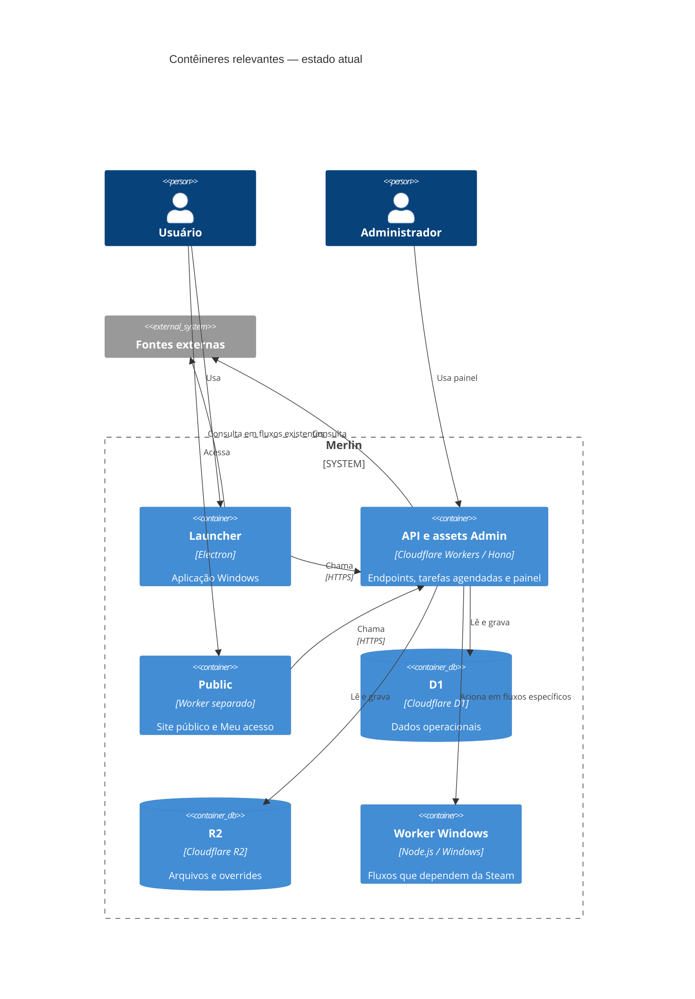
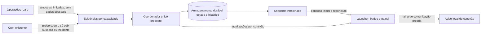

# Plano técnico — disponibilidade e instabilidades do Merlin

> Registro histórico da investigação e das decisões anteriores. A implementação atual está no código da API, do Admin e do Launcher; os critérios e o estado de deploy descritos abaixo podem estar desatualizados.

**Situação: investigação e proposta para aprovação, sem implementação.** Referência: código local em 08/11/2026, Launcher `358f6c2`, API `b1552aa`, Admin `9b6168b`. Produção e configurações mudam; reconferir antes de implementar. Este plano complementa `SERVICE_STATUS_UX_PROPOSAL.md`: decisões de UX explicitamente aprovadas nesta task prevalecem sobre aquela proposta anterior, em particular sem banners por aba, aviso de fallback ou nomes de fornecedores.

**Regras adicionais do usuário:** não usar `gepetto` neste trabalho sem necessidade concreta; não acrescentar diagramas apenas para embelezar o plano; priorizar experimentos seguros e medições reais para resolver as dúvidas técnicas pendentes, dentro do escopo autorizado.

## 1. Resumo executivo

**Recomendação revisada, sujeita à validação e aprovação:** para tráfego alto e estado que muda raramente, priorizar protótipo de **WebSocket com hibernação em um Durable Object**, que também coordene snapshot/histórico e alarmes, com snapshot no handshake e reconciliação ao reconectar. A proposta anterior de polling a cada 30 s deixa de ser a recomendação principal: para 10.000 clientes contínuos produz 864 milhões de requisições/mês, e cache/ETag não eliminam necessariamente a cobrança por requisição. Polling adaptativo mais lento é contingência e opção de menor mudança se o número real de clientes simultâneos e o SLO o justificarem. Nenhuma tecnologia ou novo recurso é aprovado para implantação por este documento.

**Limite importante:** não é possível inferir indisponibilidade total a partir de uma fonte, de um único jogo, de um HTTP 200 ou de ausência de tráfego. A remoção em 10–20 s é **meta**, não garantia: exige um probe válido, confirmação com intervalo e distribuição mais frequente; o cron atual de 1 minuto, sozinho, não atende ao requisito. Onde não houver teste seguro e representativo, publicar somente o impacto comprovado e marcar evidência como expirada internamente; não inventar recuperação ou outage.

**Aprovado:** uma badge no canto superior direito, invisível sem incidentes confirmados; clique abre painel não modal, lista independente por área, sem nomes de fornecedores, sem banners duplicados ou notificações repetidas. Fechar painel não resolve incidente. Uma única badge genérica `Instabilidade` quando houver dois ou mais incidentes. Modal antiga preservada no código, sem abertura automática no novo fluxo. Textos exatos estão na seção 10.

## 2. Skills e fontes consultadas

- A primeira versão deste plano não conhecia o toolkit indicado posteriormente pelo usuário. Na revisão, foram lidas e aplicadas `c4-architecture`, `mermaid-diagrams` e `database-schema-designer` do repositório irmão `agent-toolkit`: separação entre sistema atual e proposta, diagramas de contexto/contêineres, padrões de acesso, integridade, índices e compatibilidade de migração. São instruções locais consultadas diretamente, não skills automaticamente instaladas no Codex.
- Foram avaliadas `qa-test-planner` e `backend-to-frontend-handoff-docs`, mas não executadas: a primeira exige invocação explícita pelo nome e a segunda se destina a uma API já implementada. `gepetto` requer invocação específica com arquivo Markdown e um fluxo extenso; não foi utilizado nesta revisão. As prioridades do usuário e as regras do Merlin prevalecem sobre exemplos genéricos do toolkit.
- Na revisão comparativa de comunicação e persistência, reaplicou-se `database-schema-designer` à análise de padrões de acesso, integridade, retenção e rollback; os exemplos genéricos não foram tratados como implementação D1 ou DO. Não foi identificada skill disponível específica de Cloudflare, resiliência ou desempenho; foram utilizadas documentação oficial, código existente e simulação local. Não se criou outro diagrama nem se usou `gepetto`.
- Instruções `merlin-api/AGENTS.md` e `docs/CHANGE_GUARDRAILS.md` do Launcher, documentação e testes dos repositórios; o guardrail autoriza documentação pedida, não mudança funcional nesta tarefa.
- Documentação primária atual: [Workers — boas práticas](https://developers.cloudflare.com/workers/best-practices/workers-best-practices/), [limites](https://developers.cloudflare.com/workers/platform/limits/), [Cache API](https://developers.cloudflare.com/workers/runtime-apis/cache/), [Workers Cache](https://developers.cloudflare.com/workers/cache/), [D1 preços](https://developers.cloudflare.com/d1/platform/pricing/), [Durable Objects e WebSockets](https://developers.cloudflare.com/durable-objects/best-practices/websockets/), [alarmes DO](https://developers.cloudflare.com/durable-objects/api/alarms/), [preços DO](https://developers.cloudflare.com/durable-objects/platform/pricing/), [preços Workers](https://developers.cloudflare.com/workers/platform/pricing/). Validar documentação e plano contratado novamente antes de estimar cobranças.

## 3. Arquitetura e comportamento atuais

**Confirmado no código:**

- API Hono/Workers (`merlin-api/src/index.ts`, `wrangler.jsonc`), D1 `merlin_db`, três buckets R2 e fila de indexação. API e Admin compartilham Worker/assets; Public é separado. Worker Windows é serviço distinto usado em fluxos Steam; não é canal de status do Launcher. Cron atual em produção e staging é a cada minuto; produção executa diversas tarefas; staging tem política específica. Não assumir número fixo de instâncias: Workers pode executar múltiplos isolates/locais e reciclá-los; não há servidor único persistente.
- Não foram encontrados Redis, Durable Object, SSE ou WebSocket API↔Launcher nesse fluxo. Existe WebSocket em `src/main/steam-plugin/steam-plugin-service.js`, ligado ao depurador da Steam, **não reutilizável** como fan-out da API. Há timers de anúncios/enquetes e `visibilitychange`, mas não um canal de status central. O Cache API da Cloudflare é local ao data center e não replica globalmente; cache não é lock ou fonte de verdade.
- `/api/health` em `src/index.ts` informa `online`; não verifica D1, R2 nem fornecedores. Uma resposta saudável confirma apenas a rota alcançada. Em `main.js`, fechar a janela pode ocultá-la na bandeja se plugin/cloud sync estiver ativo; janela tem isolamento de contexto, `nodeIntegration: false`, e a miníma é 1200×800. Não foi encontrado `powerMonitor` de retomada específico para status. Ocultação, suspensão Windows, throttling e religamento devem ser medidos, não presumidos; utilizar main/preload/IPC já existentes caso necessário.
- `src/renderer/shared/service-status.js`: health **direto do Ryuu**, primeira consulta ao carregar e a cada 120 s; timeout 5 s, retry após 1,5 s, duas falhas abrem modal uma vez. `markServiceResponsive()` limpa o mesmo estado, inclusive por sucessos em Add Games, Premium e Correções. Portanto pode tanto indicar genericamente a partir de uma dependência quanto apagar um aviso pelo sucesso de outra. HTML põe badge atual em `.header-brand`, não na posição superior direita aprovada. Não remover a modal; criar separação e teste explícito para desativar sua abertura automática quando o novo fluxo for habilitado, com rollback seguro.
- IPC e monitoramento de rede deverão permanecer isolados de instalação/ativação. Ver `index.html`, `styles.css`, `src/renderer/shared/service-status.js`, `preload.js`, `main.js`, `test/service-status.test.js` e `docs/CHANGE_GUARDRAILS.md`. Não há evidência de que troca de visibilidade ou suspensão já sincronize status.

### Contexto confirmado — visão C4 nível 1



### Contêineres confirmados — visão C4 nível 2



Esses diagramas descrevem as relações gerais confirmadas; não afirmam que cada rota, fluxo ou recurso de status já esteja implementado. A proposta futura está no diagrama da seção 6.

## 4. Cascata real de Adicionar jogos

**Confirmado:** `merlin-api/src/endpoints/manifests.ts` exige licença, aplica rate limit e limite de licença de teste; consulta primeiro override obrigatório no R2 por jogo. Se existir e for válido, entrega ZIP; erro de override não deve ser confundido com falha geral de provedores. Depois `getManifestSourceSettings` lê D1: fonte primária configurável e as demais na ordem de `manifestPrimarySourceOrder`, padrão **Hubcap → Ryuu → DepotBox → Steam API**. Elas só entram se credenciais/config necessárias existirem. Em seguida vêm Skyflare e três URLs GitHub para o mesmo repositório/ramo: não contá-las como três alternativas independentes. Steam API usa serviço SteamTools, consulta depots antes do ZIP; não equivale a qualquer jogo disponível.

O loop é sequencial, cada fonte faz no máximo uma tentativa de download; 429/5xx são classificáveis como transitórios, mas `maxAttempts: 1` impede repetição dentro dessa fonte. Timeouts diferem entre primárias e fallback; ler constantes antes de alterá-las. Valida cabeçalho ZIP e retorna no primeiro sucesso. Hubcap executa checagem de cota em `src/lib/hubcap-quota.ts`; circuito em D1 pausa até horário de rechecagem e checa novamente sob demanda. Falha de consulta de cota também faz pular Hubcap; `request_failed` atual não distingue completamente cota, infraestrutura e resposta inválida. Contrary **não é fonte ativa na cascata atual**: `migrations/0069_manifest_source_steam_api.sql` migra a antiga configuração `contrary` para `steam-api`; não restaurá-la por referência histórica.

`fetchSource` produz `missing` para HTTP 404 e `unavailable` para os demais erros/ZIP inválido; SteamTools sem depots é atualmente `unavailable`, embora possa ser particular ao jogo. Sucesso retorna `response` junto de um `outcome` artificial com `result: missing`: o monitor futuro precisa testar **primeiro a resposta válida**, nunca contar esse `outcome` de sucesso como ausência. No fim, todos `missing` → `manifest_unavailable`; qualquer `unavailable` → `manifest_sources_unavailable`, ambos retornados como JSON de negócio HTTP 200. Esse último código descreve **a tentativa daquele jogo**, não comprova indisponibilidade global. Registros incluem App ID, nome de fonte, estágio, motivo e status; atividade de usuário tem dados de licença/HWID/IP, portanto não copiar para histórico público de incidentes. Eventos precisam de classificação semântica por fonte e capacidade, deduplicação por operação e de distinguir erros individuais de correlação entre jogos.

**Hipótese a validar:** taxa de falhas por amostragem de operações independentes e jogos diferentes pode indicar limitação, desde que o resultado final da cascata e a cobertura observada sejam considerados. Falha de fornecedor com sucesso de alternativa não é alerta nem limitação por si só. Não chamar endpoint real de manifestação como probe: ele exige licença, impõe rate limit e registra atividade/ativação.

## 5. Correções e imagens

**Confirmado:** `src/endpoints/fixes-catalog.ts` consulta catálogo Ryuu com timeout de 4 s, normaliza e combina `overrides.json` no R2 (`src/lib/overrides.ts`). Override de correção habilitado e com nome pode gerar entrada própria e seu link aponta para `/api/fixes/download`; itens ocultos saem. Se catálogo remoto falha, ainda pode retornar catálogo de overrides; se nenhum item e remoto indisponível retorna 502. Retornar itens não comprova que todos os arquivos são baixáveis. `fixes-download.ts` atende R2 real via `getFixOverrideFile`, ou proxy Ryuu/DepotBox conforme source; não é apenas metadado, e não há fallback automático entre arquivos por jogo. Um 404 particular, ausência do objeto ou falha de download não prova falha de todo o catálogo. O Admin possui importação/overrides; existência e cobertura do acervo completo não foram medidas.

Não foi encontrada flag para desligar Ryuu **nas Correções**. `game_image_source_settings.ryuu_enabled` (`0094_game_image_sources.sql`) controla política de imagens no backend e não é essa flag. Futura flag é decisão separada: comparar catálogo elegível esperado com itens realmente distribuídos e baixáveis; quando tudo esperado funciona no acervo próprio, desativar fornecedor é estado normal, não incidente. Redução intencional só gera texto de catálogo reduzido se sua causa e impacto estiverem efetivamente confirmados; não inferir de configuração.

**Imagens:** `src/main/games/game-cover-service.js` armazena arquivos por App ID no cache do usuário, conserva fotos antigas e revalida após 24 h; até 4 downloads em paralelo, timeout 4 s por origem, valida tipo e assinatura, tenta imagem preferida permitida Steam/Merlin e depois Ryuu; circuito de Ryuu é local ao Launcher. `src/renderer/shared/game-covers.js` tem lazy loading e limite visual de 10 s; Correções, Premium e Biblioteca usam placeholders em falhas. `library-service.js` devolve itens locais/cache e completa metadados em background: a observação antiga em `SERVICE_STATUS_UX_PROPOSAL.md` de bloqueio da Biblioteca já não descreve a versão atual. `games-search.ts` e `public-catalog.ts` têm fontes distintas e URLs de imagens. Catálogo de Correções, arquivo de Correções e imagens são rotas/caches diferentes: podem falhar juntos ou separadamente, mas não há sinal central confiável de impacto agregado nas imagens nem visibilidade central dos caches locais. **Recomendação:** não ativar indicador de imagens na primeira versão; depender de validação de amostragem representativa, privacidade e canários sem gerar tráfego excessivo.

## 6. Evidência, estados e recuperação

### Classificação

| Evidência | Tratamento recomendado |
|---|---|
| Jogo 404/sem conteúdo, licença inválida, plano/permissão, cooldown, limite de licença, arquivo específico ausente | `negocio`/`item`; nunca contam como outage global. Um 404 de rota essencial em probe conhecido precisa de classificação específica, não da regra genérica de App ID. |
| Timeout, conexão, 5xx, 429 de capacidade, autenticação interna de fornecedor, payload inválido repetido | `operacional_suspeito`; verificar semântica, rota, abrangência e se alternativa resolveu operação. 429 da licença/usuário não é limite operacional da plataforma. |
| ZIP válido da operação final ou download verificado | Evidência positiva somente da funcionalidade/caminho/jogo observado; não provar saúde universal. |
| Fonte desativada de propósito, ausência de credencial configurada, dados insuficientes | `nao_aplicavel` ou `desconhecido`; não falha automática. Se configuração inesperadamente impede função, requer confirmação de impacto. |

Internamente usar `normal`, `suspeito`, `limitado`, `indisponivel`, `recuperando`, `sem_dados`. Máquina por **capacidade** e não por fornecedor; suspeita não muda UI. Duas funções podem divergir. Consolidar por resultado final e cobertura do catálogo, não pela mera ordem de fallback. Retries automáticos dentro da mesma operação e vários URLs do mesmo repositório não são amostras independentes. Para Correções, o usuário aceitou usar tentativas reais repetidas, inclusive da mesma pessoa e do mesmo arquivo, como sinal; a seção 17 detalha o tratamento de falhas locais e não afirma que essas tentativas comprovam indisponibilidade total. Não contar sucesso em Premium como recuperação de Correções. Operações que chegaram a uma alternativa válida são sucesso para esse jogo, não prova de cobertura total.



O diagrama é propositivo; não afirma que coletores, canários, endpoint, cache ou tabelas já existam. Um probe sem permissão ou sem representatividade não entra no desenho de produção.

**Hipóteses para calibrar, não valores aprovados:** janela deslizante ~45 s e 3 falhas operacionais independentes em caminhos/jogos distintos; uma falha abre `suspeito`, não publicar só porque o relógio passou. Com baixo volume, iniciar probe controlado após suspeita, sem esperar três usuários, mas sem concluir outage se probe não cobrir as alternativas. Para `limitado`, exigir redução de capacidade demonstrável e pelo menos uma alternativa realmente utilizável; para `indisponivel`, evidência representativa de impossibilidade da funcionalidade e de todas as alternativas relevantes, inclusive R2, não um conjunto de 404s. Se isso não puder ser provado, manter `sem_dados`/suspeita e erro da ação, não publicar indisponibilidade total. A cobertura e limiares devem ser aprovados após medições reais anonimizadas.

**Recuperação:** 2 sucessos relevantes e independentes, separados inicialmente por 10–15 s, dentro de janela válida, com a mesma abrangência mínima do impacto anunciado; confirmar cada área separadamente. Sucesso parcial pode reduzir gravidade sem encerrar incidente. Não considerar 200 em `/api/health` ou HEAD do fornecedor suficiente para confirmar download. Falhas transitórias durante recuperação reiniciam ou prolongam a confirmação, sem flapping; incidentes repetidos ficam correlacionados. Depois do primeiro sucesso, 2º a ~12 s + polling de até 15 s + TTL de cache de até 5 s pode levar **12–32 s**, mais agendamento/rede. Desde a recuperação real, desconhecida até o próximo probe, pode demorar ainda mais. Objetivo 10–20 s demanda medições, política de 5–10 s e/ou canal diferente e custos maiores; não prometer SLO enquanto a capacidade de canário e o agendamento não forem demonstrados.

O cron de 1 min pode iniciar reconfirmação sem usuário, mas tem até ~60 s de atraso antes de iniciar. Na alternativa D1, dois probes podem ocorrer separados ~12 s no mesmo ciclo, com lock de escopo limitado e tolerância a cancelamento; não se deve confiar em `waitUntil` como agenda durável. Na candidata DO, alarmes persistentes podem acordar o coordenador, inclusive sem clientes: uma agenda única gerencia capacidades e, quando há suspeita/incidente, propõe-se intervalo de 15 s; após primeiro sucesso, segundo após ~12 s, em novo alarme. Em condição normal, o cron de um minuto pode manter vigilância mínima, somente para probes comprovadamente seguros. Alarmes são pelo menos uma vez, podem atrasar ou repetir e cada objeto tem um alarme por vez; persistir agenda e deduplicar, sem prometer horário exato. Inicialização, perda do alarme, falha/reinício e reconciliação pela execução periódica precisam de teste. Nunca depender de cada cliente, baixar arquivos grandes, reservar Premium, gravar licenças, disparar ativação ou alterar fornecedores.

**Canário ainda não identificado:** somente endpoint de teste autorizado, sem efeitos, com App IDs conhecidos, cobertura por capacidade, tempo máximo, limite de taxa global, validação mínima real de conteúdo e cancelamento de corpo; validar se HEAD/Range é suportado e representativo. Não usar chamadas reais sujeitas a cota sem permissão. Se fornecedor não oferecer probe seguro, estado envelhece para `sem_dados`; uma operação real representativa ou confirmação administrativa deve recuperar. Sucesso de cache local não demonstra recuperação remota.

### Matriz de verificações com zero tráfego — investigação no código

| Capacidade | Sinal encontrado | O que comprova | O que não comprova / condição para usar |
|---|---|---|---|
| API Merlin | `/api/health` retorna estado fixo | Uma resposta da rota naquele momento. | Não comprova banco, R2, Correções nem cascata; falha no PC é comunicação local. |
| Hubcap | Endpoint de estatísticas em `hubcap-quota.ts` | Pode informar cota e se novas requisições são permitidas. | Não confirma manifesto válido, cobertura de jogos ou isenção de cota; ver documentação/contrato e permissão antes de usá-lo como canário. |
| Ryuu manifestos | `RYU_API_URL`, credencial e download por App ID | Implementação real usa geração/download. | Não foi identificado probe sem ativação/cota e sem conteúdo; health atual `downloads_available` é sinal auxiliar, não confirmação de função. |
| DepotBox / SteamTools / GitHub / Skyflare | Endpoints de download e, para SteamTools, generate/depots | Caminho usado em operação real. | Nenhum endpoint de teste representativo e sem custo foi identificado. Consultar contrato/suporte; não experimentar com credenciais ou App IDs de usuário. |
| Catálogo de Correções | `fixes.json` remoto e merge de overrides locais | Catálogo sintaticamente válido e disponibilidade parcial de metadados se consultado com segurança. | Não garante arquivos baixáveis. Tamanho, cache, custo e permissão de consulta periódica ainda desconhecidos. |
| Arquivo próprio de Correções | Override existente em R2 | Um objeto de teste próprio, conhecido e inofensivo pode futuramente validar metadados/leitura mínima do caminho R2. | HEAD sozinho não valida download completo; um objeto de teste não comprova todos os arquivos, nem o caminho remoto. Requer criar/selecionar objeto com autorização em implementação futura. |
| Imagens | Cache local, fontes preferidas e fallback | Uma imagem de teste autorizada valida apenas aquela origem/objeto. | Falta de uma imagem pode ser legítima; caches e múltiplas origens impedem inferir impacto global. Fora da primeira entrega. |

**Limitação inevitável:** não foi identificado canário seguro representativo para a cadeia de manifestos. Sem contrato de verificação fornecido/autorizado não é possível prometer detecção e recuperação confiáveis de indisponibilidade total com zero tráfego. Alternativas: (1) negociar health/canário sem custo com fornecedores; (2) manter arquivos de teste próprios e um endpoint dedicado que valide os componentes sob nosso controle, sem afirmar saúde dos terceiros; (3) usar observação passiva com `sem_dados` após expiração e confirmação operacional humana para incidentes sem probe; (4) se fornecedor autorizar, probe autenticado com conteúdo sintético pequeno, cotas, limite global e validação semântica; (5) adiar indicador global dessa capacidade. Não é tecnicamente honesto inferir disponibilidade universal a partir de health, amostra única ou passagem de tempo.

### Simulação local de latência — realizada, não benchmark de infraestrutura

Foi executada simulação matemática em memória, sem rede, com 100.000 sorteios pseudoaleatórios (semente 23491). Hipóteses: recuperação distribuída uniformemente entre dois disparos; primeiro probe após o próximo ciclo; segundo sucesso exatos 12 s depois; push fixado em 0,3 s **apenas como hipótese** ou polling com fase uniforme; sem tempo de probe, falha, cache, filas, CPU, rede, retomada, clock skew ou retries. Resultados em segundos desde recuperação real:

| Detecção + confirmação + entrega | p50 | p95 | p99 | Limite teórico sob hipóteses |
|---|---:|---:|---:|---:|
| Cron 60 s + 12 s + polling 30 s | 57,0 | 88,7 | 95,9 | 102 |
| Cron 60 s + 12 s + push 0,3 s | 42,3 | 69,3 | 71,7 | 72,3 |
| Alarme 15 s + 12 s + push 0,3 s | 19,8 | 26,5 | 27,1 | 27,3 |
| Alarme 15 s + 12 s + polling 15 s | 27,0 | 37,3 | 39,9 | 42 |

Com duas confirmações espaçadas 12 s, mesmo alarme em 15 s e push hipotético não garantem 20 s. Tempo desde recuperação real = espera até o primeiro probe + duração dos probes/intervalo de confirmação + gravação consolidada + distribuição + renderização; push só reduz a última parcela. Desde **a segunda confirmação** pode ser muito rápido, porém não foi medido. O alvo de 10–20 s precisa definir marco inicial e percentil, admitir compromisso com falsos positivos e limite de probes; a latência real será maior quando houver falhas, rede ou dispositivos suspensos.

## 7. Estado, concorrência, cache e histórico

**Comparação de persistência — propostas a testar:**

| Opção | Estado e histórico | Concorrência e recuperação | Custo e dificuldade |
|---|---|---|---|
| D1 existente | Uma tabela de snapshot, histórico e agenda; novos dados requerem migration. | CAS/versionamento e, se múltiplos cron/requests puderem executar probes concorrentes, lease com fencing; evitar inferir exclusão mútua do cron. Sem verificação automática mais rápida que a agenda usada. | Sem serviço novo; leituras de cache miss, escritas por mudança e coordenação; maior complexidade de concorrência. |
| DO SQLite **único** | Estado, revisão, agenda e histórico no armazenamento durável do objeto; nenhuma cópia obrigatória no D1. | Único coordenador lógico simplifica decisão e duplicação, mas não elimina corridas após `await`, retries de alarmes, persistência transacional, falhas ou testes de reentrância. Persistir estado antes do broadcast; reconexão lê snapshot. | Novo recurso Cloudflare sujeito a aprovação; medições de duração/armazenamento e plano necessários. Objeto único pode ser gargalo e ponto lógico de indisponibilidade; medir fan-out e recuperação. |
| DO + histórico D1 | DO é autoridade para estado e alarmes; D1 facilita consultas administrativas. | Duas escritas não são transação conjunta: usar outbox durável no DO + ID/revisão únicos, consumidor idempotente e retry; reconciliar após falha. | Mais componentes e escritas; somente se uma necessidade real de consultar histórico no D1 justificar. |

**Escolha provisória mais simples para a candidata WS:** DO SQLite sozinho para estado consolidado e histórico, sem espelhar D1 no início. Registrar alterações de incidente e revisão de forma atômica no armazenamento do objeto; emitir mensagens após persistência. Não gravar cada requisição ou sucesso normal. Persistir agregados mínimos só quando necessário para confirmar suspeita/recuperação; limitar e amostrar evidências passivas, deduplicar tentativas da mesma operação e medir perdas. Um objeto único significa coordenação lógica, não disponibilidade absoluta: snapshot e reconexão precisam lidar com indisponibilidade do objeto. Se confirmação exige evidências originadas em múltiplos isolates, contabilizar custo de envio e limites; nunca alegar que amostragem dá teto global exato. Diagnóstico técnico sem credenciais, IP, HWID, licença ou App ID; retenção de 90 dias é apenas proposta.

Para histórico, modelar incidente e transições com identificador único e revisão, início/confirmação/fim e capacidade; limitar índices aos padrões reais de consulta e limpeza em lotes. Política de backup/retenção, acesso administrativo, migração compatível, rollback sem exclusão e recuperação são decisões a validar. Não prometer zero perda sem teste de transação e recuperação. Uma sincronização para D1 exige outbox; não gravar estado em dois bancos na mesma operação supondo atomicidade. Na alternativa D1, `Cache-Control`/ETag e cache por colo devem ser testados, inclusive concorrência no miss; não usar cache como coordenador. Nunca compartilhar resposta privada por chave pública.

## 8. Distribuição: comparação e custo

| Alternativa | Compatibilidade / complexidade | Memória, CPU e conexões | Requisições e custo | Atualização, recuperação e riscos |
|---|---|---|---|---|
| Canal existente | Não encontrado canal API↔Launcher; websocket Steam é outra finalidade. | Sem reaproveitamento real. | Não estimável. | Não fingir integração inexistente. |
| SSE em Worker | Sem fan-out existente; coordenação entre isolates continua necessária; média/alta. | N conexões longas, heartbeat e memória reais não medidos; conexões podem cair por reinício/proxy. | Aberturas/reconexões; coração em stream consome tráfego e CPU; não há hibernação equivalente do DO para streams SSE. | Atualização rápida depois de consolidada, snapshot/reconnect obrigatórios; não resolve sozinho agendamento de probes ou estado global. |
| WebSocket + DO hibernável, candidato | Novo binding/objeto/alarme, não implantado; prototipar somente com aprovação. | N sockets na borda, objeto hibernável em repouso; cada broadcast, evento e alarme pode acordá-lo. Memória e tempo real de fan-out precisam de teste; objeto único pode ser gargalo. | Upgrades/reconexões no Worker e no DO, operações, armazenamento e duração ativa do DO; protocolo ping e auto-response diferem de mensagens que acordam JS. | Snapshot inicial + push da revisão; volta de suspensão/reconexão sincroniza estado. Latência baixa após publicação é hipótese, não SLO medido. |
| Polling adaptativo | HTTP já existe, menor mudança operacional. | Sem conexões permanentes; timer por cliente, custo de CPU/DB depende de cache. | Requisições a cada intervalo mesmo com `304`, inclusive potencial cobrança de cache do Worker; ver tabela. | Simples e resiliente com snapshot, mas frequência/custo versus latência é compromisso explícito. |
| Híbrido WS + snapshot | Mesmo canal entrega snapshot ao abrir; HTTP condicional apenas em reconexão degradada ou fallback, não polling adicional contínuo por padrão. | Conexões WS mais HTTP quando necessário. | Upgrades + fallback limitado e suas requisições; medir duração do DO. | Protege clientes/proxies sem WS, mas complexidade de dois caminhos e reconciliação deve ser testada. |

**Premissas ilustrativas, não capacidade nem orçamento:** N Launchers realmente abertos com polling a cada 30 s (inclusive incidentes para comparar), 24 h/dia por 30 dias, sem jitter extra, retries, retomadas nem cache de navegador: `rpm = N×60/30`; `mês = rpm×43.200`.

| Clientes N | Poll 30 s req/min | Req/30 dias | Poll incidente 15 s req/min | SSE/WS conexões simultâneas |
|---:|---:|---:|---:|---:|
| 100 | 200 | 8,64 milhões | 400 | até 100 |
| 1.000 | 2.000 | 86,4 milhões | 4.000 | até 1.000 |
| 10.000 | 20.000 | 864 milhões | 40.000 | até 10.000 |

No pior exemplo hipotético de corpo comprimido de 1 KB em **todas** as respostas, o polling 30 s teria aproximadamente 8,64/86,4/864 GB de corpo em 30 dias, sem headers/TLS/retries; 304 reduz corpo, não necessariamente cabeçalhos. Esses são limites aritméticos, não medição, e não incluem cobrança de tráfego, CPU, conexões, cache misses ou D1. CDN/colo e Worker são camadas distintas: contagem de invocações e leituras D1 dependem de hit real, localidades e se cache anterior ao Worker foi de fato habilitado. Testar: por exemplo, se cada miss ler uma linha, leituras D1 ≤ misses de snapshot mais manutenção; não assumir hit ou custo zero. Em 15 s as requisições são o dobro. Backoff de 60–120 s em janela oculta pode reduzir tráfego, mas não existe economia verificável sem medir a proporção de clientes ocultos.

### Custo comparativo — tarifas públicas, não fatura do Merlin

Em 08/11/2026, a [tabela Workers Standard](https://developers.cloudflare.com/workers/platform/pricing/) informa 10 milhões de requisições incluídas/mês e US$ 0,30 por milhão adicional; [DO SQLite](https://developers.cloudflare.com/durable-objects/platform/pricing/) informa 1 milhão de requisições incluídas/mês e US$ 0,15 por milhão adicional, além de duração e armazenamento. Franquias são compartilhadas com o resto da conta. **Não verificamos o plano contratado, consumo, cache, arredondamento de cobrança, duração ativa, memória ou banda:** os valores seguintes são somente componentes ilustrativos, não orçamento total nem preço confirmado para esta conta.

| Clientes 24h/dia | Poll 30 s: req/mês | Só componente Worker, se franquia já consumida | Poll 120 s: req/mês | WS: conexões/mês com 1 reconexão por cliente/dia |
|---:|---:|---:|---:|---:|
| 100 | 8,64 mi | até US$ 2,59 | 2,16 mi | ~3.000 |
| 1.000 | 86,4 mi | até US$ 25,92 | 21,6 mi | ~30.000 |
| 10.000 | 864 mi | até US$ 259,20 | 216 mi | ~300.000 |

O componente Worker acima é `requisições/1 milhão × US$ 0,30`, supondo franquia completamente usada por outros workloads; se inteiramente livre, subtrair até 10 milhões antes da tarifa (no cenário 10.000/30 s: US$ 256,20). Não inclui base do plano, CPU, storage, DO, D1, rede, impostos ou sobrecarga. Para 120 s, o mesmo limite marginal seria aproximadamente US$ 0,65/6,48/64,80. Cache do Worker pode reduzir CPU e leituras na origem, mas a documentação informa que **requisições servidas pelo Workers Cache também são cobradas**; cache HTTP/304 não significa requisição gratuita. ETag reduz corpo e revalidação pode ainda atingir Worker/DB. O tráfego do cache externo, se aplicável, exige confirmação específica de produto e rota.

Em WS, 1 reconexão/dia é hipótese otimista para comparação, não previsão: a cada conexão ingressam tipicamente uma requisição Worker e uma DO; 300.000 conexões/mês implicariam, com franquias já esgotadas e sem arredondamento, cerca de US$ 0,09 Worker + US$ 0,045 DO só por esses ingressos para 10.000 clientes. Acrescentar mensagens de aplicação, wakeups de alarmes, chamadas de evidência, CPU do Worker, duração de DO a 128 MB cobrados, storage, distribuição, reconexões por deploy/perda de rede e o restante da conta. A Cloudflare descreve hibernação, não cobrança de duração enquanto elegível, e tratamento próprio para ping de protocolo e auto-response; mensagens de aplicação que acordam o objeto custam recursos. Um alarme a cada 15 s por 30 dias corresponde a 172.800 disparos por objeto antes de retries; ele acorda o objeto, gera operações de storage/agendamento e não deve ser considerado grátis. Usar intervalo acelerado só durante suspeita/incidente e medir duração de janela não hibernável. Broadcast para 10.000 conexões tem custo e latência não medidos; não deduzir capacidade do limite teórico de conexões.

Para SSE, apenas como cenário de interrupção forçada **hipotética** a cada 20 min: 216 mil/2,16 milhões/21,6 milhões de reconexões mensais para 100/1.000/10.000 clientes, além de heartbeats. Cloudflare documenta janela de drenagem de até 20 min durante atualizações do runtime, não que toda conexão caia em 20 min; a vida média real deve ser medida. Com 1 reconexão diária SSE teria os mesmos 3 mil/30 mil/300 mil ingressos do WS, mas SSE sem coordenador/fan-out não oferece a mesma arquitetura de estado. Comparação justa deve medir duração real de conexões e custo completo, não assumir uma reconexão por dia em um e uma a cada 20 minutos no outro.

**Conclusão:** para 10.000 clientes contínuos e alterações raras, WS hibernável tem potencial de reduzir muito requisições e latência de distribuição; os números não demonstram custo total nem capacidade de fan-out. SSE também pode reduzir requisições, mas não soluciona por si só coordenação, reconexão e alarmes. Polling de 120 s reduz custo em 75% frente a 30 s, mas adiciona atraso e não cumpre a mesma meta de entrega. Recomendar WS+DO como candidato a experimento, não como decisão definitiva ou autorização de contratar/implantar. Se os testes, o plano ou o custo não sustentarem essa opção, manter D1 + polling adaptativo como contingência.

### Ensaio local controlado — 08/11/2026

**Medição real local, não Cloudflare:** Node 22.22.3, biblioteca `ws` 8.22.1 já instalada no Launcher; servidor HTTP e clientes na mesma máquina via `127.0.0.1`, um processo para servidor e todos os clientes, payload JSON sintético único de 74 bytes. Sem instalar dependências, sem autenticação, sem solicitações a fornecedores e sem tocar os serviços do Merlin. Para SSE/WS, abrir todas as conexões, aguardar 100 ms e enviar um evento; para HTTP, iniciar uma rodada simultânea de GETs. Uma execução por cenário, sem aquecimento ou teste de longa duração:

| Transporte | Clientes que receberam | p50 | p95 | Máximo | Variação RSS do processo todo | CPU acumulada do processo todo |
|---|---:|---:|---:|---:|---:|---:|
| WebSocket | 100/100 | 3,25 ms | 3,69 ms | 3,73 ms | +8,4 MiB | 62 ms |
| SSE | 100/100 | 3,22 ms | 3,89 ms | 3,95 ms | +8,6 MiB | 47 ms |
| HTTP: rodada de GETs | 100/100 | 42,38 ms | 51,39 ms | 53,58 ms | +8,7 MiB | 110 ms |

Os percentis de SSE/WS medem somente tempo após início do envio no servidor; os de HTTP incluem abertura de conexões e rodada simultânea. **Não são medidas diretamente equivalentes de detecção, nem provam qual arquitetura é mais rápida em produção.** RSS e CPU incluem servidor, clientes, inicialização e limpeza no mesmo processo; não representam memória por cliente ou custo de Worker/DO. Não foram medidos custo de ociosidade, conectividade móvel, TLS, Cloudflare, cache, hibernação ou egress. O tamanho acima é do conteúdo gerado, sem cabeçalhos/framing; confirmar em reprodução antes de usar para custo.

Tentativas de abrir 1.000 conexões/GETs simultaneamente retornaram `ECONNREFUSED` em WS, SSE e HTTP; WS foi repetido com backlog solicitado de 2.048 e também falhou. **Causa não identificada:** não interpretar como limite de capacidade de nenhum transporte, Windows ou Cloudflare. O ensaio de 10.000 não foi executado porque o de 1.000 falhou. Para avançar, reproduzir com abertura em lotes, registrar causa, medir limitações do host, separar processos e observar estabilidade; se isso falhar, usar ambiente local adequado. Não extrapolar o ensaio pequeno nem selecionar transporte somente por estes números.

## 9. Contrato e sincronização

Exemplo proposto, sem dados operacionais ou fornecedores:

```json
{
  "schemaVersion": 1,
  "revision": 42,
  "generatedAt": "2026-11-08T12:00:00Z",
  "validUntil": "2026-11-08T12:00:30Z",
  "incidents": [
    {"id":"incident-123", "feature":"corrections", "impact":"limited", "severity":"warning", "messageKey":"corrections_limited", "confirmedAt":"2026-11-08T11:59:00Z", "updatedAt":"2026-11-08T12:00:00Z"}
  ]
}
```

Mapa permitido: `corrections`/`limited|unavailable`, `add_games`/`limited|unavailable`; `images` condicionado a evidência; `api_communication` é local ao Launcher e não afirma outage central. `incidents: []` resolve todos os incidentes **somente se snapshot íntegro, fresco e com revisão maior ou igual**; revisão menor é descartada, igualdade não renova dados expirados sem confirmação adequada. Resolver um item remove só aquele ID; proteção contra rollback deve sobreviver ao ciclo do app, sem persistir dados pessoais; pensar em epoch para restauração de banco que faça versão voltar. ETag opaco e compatibilidade de esquema com clientes antigos. Validar body, limite de tamanho e tipos, ordenação, duplicatas, clock skew, cache e resposta 304 (nunca atualizar validade de um snapshot sem comprovar cabeçalhos corretos).

Sincronização inicial via snapshot no canal WS e após reconexão, `online`, foco/visibilidade e evento de retomada do sistema: snapshot completo; coalescer solicitações sobrepostas, timeout e backoff exponencial limitado com jitter, evitando carimbo de 10 mil clientes. Na contingência HTTP, carregar snapshot condicional no início/retorno e consultar em intervalos adaptativos; não somar polling frequente ao WS saudável. Main controla ciclo e `powerMonitor`/IPC se aprovado; renderer apresenta estado, sem usar status do websocket Steam. Em background, política de conexão e consumo será medida; sincronizar antes de mostrar UI. Se API não responde repetidamente, indicador local `Sem conexão com o Merlin`, sem dizer que servidor caiu; teste online do SO não prova internet. Uma falha do canal de status não é prova de queda da API se outras requisições funcionam. Se snapshot expirar, não marcar silenciosamente `normal` nem abrir novos incidentes baseados em dados velhos: preservar último aviso como não confirmado internamente, reconciliar e pedir decisão de produto sobre texto para status desatualizado; isso é necessário para evitar badge eterna ou recuperação falsa.

Segurança: endpoint agregado sem identidade pode ser público apenas após revisão de abuso, cache e política de produto; nada de nomes de fornecedor, credenciais, URLs, App IDs, IPs ou diagnóstico interno. Caso autenticado, não compartilhar cache de resposta privada. Limitar bursts, evitar recursos consultados por cliente individual e testar impacto de rede, DNS, proxy e limites de concorrência. Não coletar licenças ou identificadores de clientes na telemetria do status.

## 10. UI e mensagens aprovadas

Uma badge compacta (ícone, texto e seta) no canto superior direito próximo aos controles sem encobri-los; âmbar limitações, vermelho indisponibilidade crítica, com texto e ícone além de cor. Ao clicar, painel ancorado não modal, sem roubo de foco; fechar só fecha painel, `Escape`, foco visível, `aria-expanded`, associação ao painel e anúncio `aria-live` discreto sem repetição. Testar zoom, escalas Windows, 1200×800 e menores se forem suportadas no futuro, maximizado, bordas, cliques, teclado, tradução e sobreposição com controles. Se dois ou mais itens, badge `Instabilidade`, título `Status do Merlin`; um único restante volta à sua badge. Manter mensagens por área, sem revelar fornecedores.

| Chave | Badge | Título | Descrição aprovada |
|---|---|---|---|
| `corrections_limited` | Correções com instabilidade | Instabilidade nas Correções | O menu de Correções está passando por instabilidades. Para garantir uma experiência melhor, removemos temporariamente algumas correções que apresentavam problemas no download. As demais correções continuam disponíveis para uso. |
| `corrections_unavailable` | Correções indisponíveis | Correções indisponíveis | Não é possível consultar ou baixar correções no momento. Estamos acompanhando a instabilidade. Tente novamente mais tarde. |
| `add_games_limited` | Adicionar jogos com instabilidade | Instabilidade ao adicionar jogos | Nosso sistema de adição de jogos está operando com algumas limitações. Alguns títulos podem estar temporariamente indisponíveis, mas você ainda pode adicionar os jogos disponíveis. |
| `add_games_unavailable` | Adicionar jogos indisponível | Adição de jogos temporariamente indisponível | Estamos enfrentando uma instabilidade que impede a adição de novos jogos à Steam pelo Merlin. Estamos trabalhando para restabelecer o serviço. Você ainda pode utilizar as demais funcionalidades disponíveis. |
| `images_limited` | Imagens com instabilidade | Instabilidade nas imagens dos jogos | Algumas imagens dos jogos podem não carregar temporariamente. Os jogos e as demais funcionalidades continuam disponíveis. |
| `api_communication` | Sem conexão com o Merlin | Não foi possível conectar ao Merlin | O Launcher não conseguiu se comunicar com os serviços do Merlin. Alguns recursos online podem não funcionar. Confira sua conexão e tente novamente. |

Preservar os dois parágrafos e textos integrais do pedido original, também quando múltiplos. Traduzir nos idiomas existentes com revisão; nenhum novo texto de fornecedor. **Atenção:** a descrição de Correções limitadas afirma que itens foram removidos; só pode ser usada após comprovar essa remoção e a existência de outras correções utilizáveis. Se houver impacto parcial diferente, não usar texto falso: decidir mensagem adicional antes da implementação.

## 11. Matriz mínima de testes futuros

Em todos: simular fontes/tempo com relógio controlado, nunca testes agressivos em provedores reais; validar nenhuma alteração em licença, Premium, ativação ou fila.

| # | Cenário | Resultado esperado |
|---:|---|---|
| 1 | Hubcap falha 1 s e volta | Sem badge global. |
| 2 | Ryuu falha 1 s e volta | Sem badge global. |
| 3 | Hubcap falha, Ryuu entrega | Sem alerta Add Games. |
| 4 | Ryuu falha, Hubcap entrega | Sem alerta Add Games; avaliar Correções/imagens separadamente. |
| 5 | Ambos falham, outra fonte mantém operação normal | Sem alerta Add Games. |
| 6 | Ambos falham, limitação real comprovada | Um item Add Games limitado. |
| 7 | Todas alternativas utilizáveis falham com abrangência comprovada | Indisponível; se evidência insuficiente, não declarar total. |
| 8 | Jogo ausente em fontes saudáveis | Erro daquele jogo; sem incidente global. |
| 9 | Cooldown | Sem incidente global. |
| 10 | Sem permissão | Sem incidente global. |
| 11 | Falhas operacionais repetidas, operações independentes | Suspeita; só confirmar impacto de função quando critérios de abrangência forem cumpridos. |
| 12 | Pouco tráfego | Probe seguro e limitado, ou sem dados; não esperar três usuários nem afirmar outage. |
| 13 | Recuperação sem solicitações | Confirmar por probes elegíveis; sem probe confiável, estado não automaticamente normal. |
| 14 | Launcher desconectado | Aviso local após confirmação; sem atribuir culpa ao servidor. |
| 15 | API reinicia durante incidente | D1 preserva revisão e incidente; reconectar com backoff e snapshot. |
| 16 | Retorno de suspensão | Um refresh coalescido e snapshot atual; sem evento antigo. |
| 17 | Duas instabilidades | Uma badge `Instabilidade`, dois itens. |
| 18 | Uma se recupera | Somente item respectivo some; badge específica restante. |
| 19 | Ambas recuperam | Painel fecha/atualiza, badge some após confirmações válidas. |
| 20 | Dependência afeta Correções e imagens | Avisos independentes apenas com evidência para cada área. |
| 21 | Apenas uma afetada | Não inferir outra a partir do mesmo provedor. |
| 22 | Ryuu desativado administrativamente | Nenhum alerta só por flag; avaliar catálogo distribuído. |
| 23 | Acervo próprio funciona | Correções utilizáveis; não declarar indisponibilidade. |
| 24 | Catálogo próprio reduzido | Aviso parcial apenas se remoção por falha e demais itens usáveis confirmados. |
| 25 | Evento/snapshot duplicado ou fora de ordem | Idempotência, não reabrir incidente fechado. |
| 26 | Reconexão em massa | Backoff/jitter, coalescência, cache e limites; sem amplificação. |
| 27 | Duas tentativas concorrentes de consolidação | Coordenador único DO mantém uma transição, mesmo com reentrância/retry; na alternativa D1, um vencedor por CAS/fencing. Sem duplicação ou escrita velha. |
| 28 | Estado antigo após recuperação | Revisão/epoch impedem reabertura; snapshot expirado não se torna normal. |

Acrescentar 404 de rota versus jogo, 429 por usuário versus quota, resposta de sucesso com `outcome` artificial `missing`, ZIP inválido isolado, `no_depots`, R2 sem objeto, cache desatualizado em múltiplos colos, flag desligada com catálogo integral/reduzido, probe interrompido, expiração de lease, 304 e headers, repetição de snapshot, rollback de D1, 5 idiomas, foco/escape, clique perto de controles e antigo modal desativado sem exclusão. Carga em staging com serviços simulados e 100/1.000/10.000 clientes: CPU/RAM por processo e conexão, p95/p99, request, rows, hit, banda, reconnect, custo projetado; definir aprovação de limites com dados reais.

## 12. Fases, dependências e aceite

1. **Descoberta e prova (bloqueante):** medir tráfego anonimizado, cobertura por fonte e catálogo, acesso seguro para canários, custos e atuais observações; definir como detectar remoção de Correções. Aceite: evidência reproduzível sem ações reais destrutivas e limiares aprovados. Nenhum indicador novo se não houver evidência.
2. **Instrumentação sem alteração de contratos:** classificar internamente resultados finais, sucesso com response, erros operacionais e de negócio; testes de regressão de cascata, atividade e proteção de licença; amostragem com orçamento e privacidade. Aceite: falha isolada e fallback saudável nunca viram alerta.
3. **Consolidação e persistência:** somente após aprovação e protótipo, DO SQLite único com snapshot/histórico e agenda persistente; ou D1 com CAS/fencing, se alternativa for escolhida. Testar reentrância após `await`, duplicação de alarme, crash, idempotência, gravação e recuperação. Aceite: histórico somente em transições, estado anterior não prevalece; limite e custo medidos.
4. **Recuperação:** implementar somente probes autorizados e representativos; candidato usa alarmes persistentes, alternativa D1 usa cron/lease. Medir p95 desde recuperação real até confirmação. Sem probe seguro, documentar limitação e deixar área fora do alerta automático. Aceite: sem efeitos em licença/ativação, limites globais comprovados.
5. **Distribuição:** testar WS hibernável com snapshot inicial e retomada, e contingência HTTP condicional; escolher somente após benchmark e aprovação. Medir latência e custo, inclusive fase de background/reconexão. Aceite: reconexão em massa, ordenação e frescor testados.
6. **Launcher:** um indicador e painel conforme textos, acessibilidade e línguas; integrar com ciclo de janela/main/preload mantendo modal antiga no código e comportamento antigo atrás de flag. Aceite: matriz UI e regressões; nenhuma dupla modal ou interferência de operações.
7. **Integrações:** Adicionar jogos e Correções independentes; imagens apenas se prova de observabilidade; futura flag de Ryuu planejada separadamente. Aceite: cenários 1–28 e distinções de fonte/capacidade passam.
8. **Rollout e rollback:** flag separada por ambiente/capacidade; sombra sem exposição, métricas agregadas, staging e grupo reduzido com percentuais e janelas a decidir, expansão após ausência de alarmes falsos e custo aceitável. Pausar/desativar indicador e coleta; versão anterior deve manter funcionamento. Não desfazer migrations destrutivamente; preservar snapshots/histórico e excluir dados segundo retenção. Garantir que o alerta/modal anterior não reapareça indevidamente ao alternar flags. API deploy segue gate `npm run validate:premium` em `merlin-api/AGENTS.md`; nenhum deploy é autorizado por este plano.

## 13. Decisões necessárias antes de implementar

1. Que probe sem efeito colateral realmente representa cada capacidade e cada alternativa? Sem ele não se pode garantir detecção de baixo tráfego nem recuperação rápida.
2. Aceitar até ~60 s para iniciar recuperação via cron e possível atraso posterior, ou aprovar o experimento com DO/alarmes e possível custo para perseguir 10–20 s? Definir início/fim exatos do SLO e p95/p99; simulação mostra que 15 s + duas confirmações em 12 s não garante 20 s.
3. Como definir quantitativamente cobertura suficiente para `limitado` e, sobretudo, `indisponível` considerando jogos diferentes, override e catálogos incompletos? Se não demonstrável, limitar UI a impacto observável por ação.
4. O que exibir quando o último incidente está obsoleto e a API não pode confirmar resolução? Não remover silenciosamente nem afirmar que continua ativo indefinidamente.
5. Condições e nova mensagem se Correções estiver parcialmente afetada sem itens terem sido removidos; retenção 90 dias; nível de detalhe visível no Admin; acesso público/autenticado do snapshot; orçamento de requisições e D1; rollout e versão mínima do Launcher.
6. A flag futura de Ryuu em Correções e a contabilização do acervo próprio são outra decisão de produto; não presumir que já existem. Imagens permanecem fora da primeira entrega até um sinal confiável ser aprovado.

### Experimentos antes de uma decisão

- **Já realizado:** simulação matemática local da seção 6. Ela mede distribuições das hipóteses, não desempenho real de rede/Cloudflare e não abriu conexões nem chamou fornecedores.
- **Próximo, parcialmente executado:** ensaio local da seção 8 validou entrega com 100 clientes por transporte, mas as tentativas de 1.000 falharam com `ECONNREFUSED`; 10.000 não foi testado. Investigar recusa e reproduzir com abertura escalonada e processos separados, usando somente runtime e dependências existentes. Medir ociosidade, operações, p50/p95/p99, backpressure, reconexão, perda e reordenação. Verificar portas/descritores e capacidades do PC; não extrapolar CPU/memória locais para Cloudflare.
- **Após aprovação separada, somente se necessário:** staging isolado e com limite de orçamento/requisições, DO temporário e fontes totalmente simuladas; conferir se plano atual já cobre uso e se criação altera infraestrutura. Medir hibernação, alarmes, escrita de storage, tempo de fan-out real, reconexão, cache e métricas de faturamento. Sem aprovação, nenhum deploy, recurso ou serviço pago. 10.000 clientes não devem ser disparados contra produção.
- **Investigar fornecedores:** obter especificação ou autorização de health/canário, contagem e limite permitido; validar conteúdo reduzido em ambiente controlado só se explicitamente permitido. Medir separadamente disponibilidade do catálogo, do arquivo e das alternativas. Ausência de contrato ou prova mantém a capacidade em `sem_dados`; não executar probe real como parte desta task.
- **Critérios de escolha:** definir SLO e orçamento antes do teste; WS só vence se distribuição, integridade, reconexão e custo total forem demonstrados dentro dos limites. Se houver falha de hibernação, custos inesperados ou fan-out insuficiente, avaliar shards com reconciliação e orçamento ou retornar ao polling mais lento. Não declarar vencedor apenas pelos preços por requisição.

## 14. Referências locais para revisão

- API: `src/endpoints/manifests.ts`, `src/lib/manifest-source-settings.ts`, `src/lib/hubcap-quota.ts`, `src/endpoints/fixes-catalog.ts`, `src/endpoints/fixes-download.ts`, `src/lib/overrides.ts`, `src/lib/fix-import.ts`, `src/endpoints/games-search.ts`, `src/endpoints/public-catalog.ts`, `src/index.ts` (`scheduled`), `wrangler.jsonc`, `migrations/0069_manifest_source_steam_api.sql`, `0094_game_image_sources.sql`; testes `tests/manifests-hubcap.test.ts`, `manifest-source-settings.test.ts`, `hubcap-quota.test.ts`, `fixes-online-filter.test.ts`.
- Launcher: `src/renderer/shared/service-status.js`, `src/renderer/shared/game-covers.js`, `src/main/games/game-cover-service.js`, `src/main/library/library-service.js`, `src/main/library/library-catalog-service.js`, `src/main/steam-plugin/steam-plugin-service.js`, `src/renderer/add-games/add-games.js`, `src/renderer/corrections/corrections.js`, `main.js`, `preload.js`, `index.html`, `styles.css`, `test/service-status.test.js`, `docs/plans/SERVICE_STATUS_UX_PROPOSAL.md`.
- Admin: `src/pages/SettingsPage.jsx` para seleção de fonte/circuito, `src/pages/OverridesPage.jsx` para revisão de overrides e `src/App.jsx` para chamadas; não há mecanismo existente comprovado de monitoramento central de status por capacidade.

## 15. Resultados da POC isolada — 08/11/2026

**Escopo e rastreabilidade:** POC em `tmp/service-status-poc/`, ignorada pelo Git, com instruções de reprodução em seu `README.md`. Node 22.22.3, `ws` 8.22.1 e Miniflare já existentes; dados fictícios e sockets somente em loopback. Os processos de teste não chamam Launcher/API, Steam, fornecedores, R2 ou D1 reais; não houve instalação, deploy, recurso Cloudflare nem migration. `qa-test-planner` foi expressamente mencionada nesta tarefa e aplicada para organizar escopo, pré-condições, resultados esperados e bloqueadores. Não se utilizou `gepetto`, nem se acrescentou diagrama.

### Carga de transporte no PC

Servidor e clientes rodaram em **processos separados**, escuta apenas em `127.0.0.1`, no máximo 30 aberturas em andamento, backlog solicitado 1.024, uma rodada por combinação, repouso observado 3 s, três snapshots WS/SSE. Os percentis têm resolução de `Date.now()` de 1 ms. Não foi utilizada rede Cloudflare. Para HTTP houve uma rodada de GETs com até 30 em andamento e conexões sem keep-alive, sem um ciclo de polling contínuo; sua latência mede requisição/resposta, não distribuição a clientes mantidos conectados. RSS são processos completos, não custo marginal por socket. A observação curta não mede consumo prolongado ou hibernação.

| Transporte | Alvo / concluídos | Falhas | Tempo abertura/rodada | p50 / p95 / p99 ms | RSS servidor / clientes MiB |
|---|---:|---:|---:|---:|---:|
| WS | 100 / 100 | 0 | 205 ms | 2 / 3 / 3 | 44,14 / 43,75 |
| SSE | 100 / 100 | 0 | 201 ms | 1 / 2 / 2 | 43,89 / 42,99 |
| HTTP | 100 / 100 | 0 | 55 ms | 13 / 26 / 27 | 44,55 / 43,34 |
| WS | 1.000 / 1.000 | 0 | 383 ms | 6 / 11 / 12 | 51,17 / 51,66 |
| SSE | 1.000 / 1.000 | 0 | 336 ms | 15 / 22 / 23 | 55,47 / 55,95 |
| HTTP | 1.000 / 1.000 | 0 | 345 ms | 10 / 14 / 25 | 46,35 / 53,38 |
| WS | 10.000 / 10.000 | 0 | 2.734 ms | 54 / 84 / 87 | 99,32 / 102,50 |
| SSE | 10.000 / 10.000 | 0 | 5.002 ms | 70 / 110 / 113 | 142,51 / 154,62 |
| HTTP | 10.000 / 10.000 | 0 | 2.533 ms | 7 / 12 / 14 | 50,50 / 116,58 |

WS/SSE mostram a **primeira das três** distribuições, com 100% dos clientes conectados recebendo cada revisão e zero duplicações detectadas nessa execução; isso não prova entrega em rede real. A primeira rodada de 10.000 foi sequencial, mas o script dessa versão não registrava CPU total. Na versão seguinte, o teste de 10.000 HTTP registrou 1.640 ms CPU servidor e 3.000 ms clientes durante toda a execução; WS e SSE foram acidentalmente sobrepostos e seus números não são comparáveis: 2.093/7.485 ms e 1.828/7.376 ms, respectivamente. Não usá-los como benchmark isolado. Nos testes sequenciais de 100 e 1.000, CPU total servidor/clientes: WS 79/250 e 298/500 ms; SSE 31/203 e 359/610 ms; HTTP 62/47 e 266/406 ms. Incluem inicialização, abertura, repouso e envio, não apenas processamento de mensagens. As leituras em repouso por 3 s apareceram geralmente como 0 ms, com algumas de 15–16 ms: resolução/intervalo insuficientes para concluir CPU zero.

Ao repetir WS 10.000 separadamente, 9.999 conectaram e uma tentativa falhou com erro que a versão anterior do experimento não registrava; `ECONNREFUSED` foi zero. Isso impede afirmar 100% reproduzível. A POC foi atualizada para contar códigos em testes futuros. Uma reconexão em massa sintética de 1.000 WS fechou as conexões e reabriu em lotes: 1.000/1.000, zero erros, 345 ms, snapshot atualizado em todos; não houve teste de reconexão de 10.000, rede instável, backpressure prolongado nem recuperação real do SO.

**Diagnóstico de `ECONNREFUSED`: parcialmente investigado.** A primeira tentativa abria 1.000 conexões de uma vez no mesmo processo e foi recusada até com backlog solicitado de 2.048. Nesta POC, com processos separados e 30 conexões concorrentes, 1.000 e uma rodada de 10.000 completaram sem `ECONNREFUSED` nos três transportes. Foram alteradas **duas variáveis** (processos e escalonamento), portanto a causa exata não foi isolada; backlog efetivo, fila de aceitação, portas efêmeras, disponibilidade do host e processamento continuam hipóteses. A falha isolada posterior mostra necessidade de capturar códigos, repetir e variar uma variável por vez. Não atribuir limite à Cloudflare ou ao WebSocket.

### Máquina de estados e persistência sintéticas

`node --test .../model.test.cjs`: **5/5 testes passaram**. Cobrem falha isolada, resultado de negócio e fallback sem alerta; deduplicação e janela de 45 s; três evidências com impacto e cobertura **fornecidos artificialmente**; duas áreas e recuperação independente; falha durante recuperação; duas evidências positivas separadas; reinício via serialização e recusa de revisão mais antiga. Sem operações não se fabrica sucesso. Não provam a capacidade de medir cobertura real, efeito de atrasos distribuídos ou funcionamento de fornecedores. A janela de 45 s é limite de retenção de amostras, não espera obrigatória: na POC, três falhas fornecidas juntas podem confirmar imediatamente se o teste também fornece impacto e cobertura. Isso exige calibração e não é regra pronta para produção. Tempo A depende do momento em que o cenário fornece a terceira evidência; tempo B de exemplo é 10 s após primeiro sucesso representativo; C é a latência local da tabela, sem rede. Não extrapolar os três para SLO de produção.

`do-local.cjs` executou **um objeto SQLite local no Miniflare** usando `acceptWebSocket`, persistiu mudança e histórico, evitou incremento em alteração duplicada, executou alarme de teste de 200 ms, preservou estado e histórico entre instâncias do runtime e recuperou snapshot depois de simular interrupção entre persistência e broadcast. Última execução: revisão 5 limitada, alarme revisão 6 normal, reinício preservou revisão 6; commit sem broadcast foi recuperado como revisão 7. O alarme sintético muda para `normal` incondicionalmente: serve apenas para testar a API local e **não é um algoritmo seguro de recuperação**. O teste não demonstrou hibernação/evicção, retries reais, alarmes distribuídos, custo, desempenho ou fan-out de um DO Cloudflare; a carga de 10.000 foi em um servidor Node comum, não no DO. Persistência de reconexão após perda de broadcast exige clientes buscarem snapshot; clientes conectados que não reconectem ainda precisam de uma estratégia de reparo a testar.

### Avaliação dos três bloqueadores

| Risco | Classificação | Evidência e limite |
|---|---|---|
| Verificação segura das fontes | **NÃO VALIDADO** | A POC usa `coverageConfirmed` fictício. Health e metadados encontrados são parciais; não foi demonstrado canário autorizado, sem efeitos e representativo da cascata, nem recuperação sem tráfego real. Estratégias da seção 6 continuam apenas viáveis sob autorização ou parciais. |
| Escalabilidade | **PARCIALMENTE VALIDADO** | Node local atingiu 10.000 em uma rodada por transporte, mas uma repetição WS falhou e causa anterior exata de recusa permanece desconhecida. Sem soak, rede real, backpressure, reconexão 10.000 ou picos confiáveis; não prova limites Workers/DO. |
| Gargalo DO | **NÃO VALIDADO** | Miniflare local demonstrou funcionamento básico de um objeto e armazenamento com uma conexão. Nenhum teste de 100/1.000/10.000 conexões, hibernação efetiva ou custos em DO. Um objeto central, coordenador + distribuidores e sharding permanecem comparações arquiteturais sem medida operacional. |

**Decisão:** nenhum bloqueador foi validado por completo; arquitetura não está aprovada para produção. A menor opção a testar continua um objeto lógico com armazenamento próprio e WS hibernável, mas sem declarar que 10.000 cabem nele ou que é mais econômico no cenário real. Só comparar sharding se as medições do objeto único demonstrarem necessidade; D1+HTTP permanece alternativa. As estimativas monetárias da seção 8 continuam modelagens, não custos medidos. É necessário obter um canário seguro ou aceitar uma funcionalidade sem indicador global, reproduzir carga com isolamento/telemetria e, se aprovado, ensaiar Miniflare/Cloudflare isolado com limites e orçamento. Nenhum novo recurso é autorizado por esta POC.

## 16. Investigação complementar: evidência real da cascata

**Situação:** análise e testes isolados, não implementação. Esta seção complementa as anteriores e não altera os textos ou comportamentos de badge aprovados. O objetivo é decidir se há evidência suficiente para um estado de funcionalidade; o transporte do status continua fora do escopo desta etapa.

### O que pode ser observado sem novos pedidos aos fornecedores

1. **Confirmado no código:** `createSources` compõe as fontes configuradas; `fetchSource` gera `response` e `outcome`; `ManifestsRoute.handle` escolhe override ou percorre a cascata, retorna no primeiro `response` utilizável e só determina `manifest_unavailable`/`manifest_sources_unavailable` quando todas foram tentadas. Observar o resultado da **operação final** e as tentativas já efetuadas não requer chamar um fornecedor novamente. É uma proposta de instrumentação futura, não um sinal agregado existente.
2. Os logs atuais de tentativa registram App ID, fonte, tipo, status e tentativa; o log de sucesso registra fonte selecionada. Eles não expõem um identificador comum de operação em todos esses eventos. Correlacionar logs pelo App ID e horário pode misturar chamadas simultâneas; portanto, **não há reconstrução confiável comprovada da cascata final só pelos logs atuais**. Não reutilizar logs de atividade de usuário com licença, IP ou HWID como base de telemetria pública.
3. `fetchSource` só valida assinatura ZIP no primeiro chunk, e o objeto pode ser entregue antes de o restante do stream terminar. O teste abaixo comprovou que uma falha posterior pode acontecer apesar de `response` presente. Fim de stream sem erro comprovaria apenas entrega integral daquele fluxo; não comprova CRC, extração, aplicação na Steam ou sucesso de outros jogos. Cancelamento deliberado pelo cliente, suspensão, falha da rede entre cliente e Merlin e erro de fornecedor devem permanecer categorias distintas, e a origem do erro só deve ser atribuída quando for observável.
4. `outcome.result = missing` acompanha até uma resposta ZIP aceita; verificar primeiro `response`, nunca contabilizar esse `outcome` como ausência. O estado Hubcap `closed` indica ausência de registro de circuito aberto, **não uma prova de disponibilidade ou quota positiva atual**. O retorno `false` de `hubcapQuotaAllows` mistura cota, erro de consulta e payload inválido; os logs distinguem alguns motivos, mas o resultado de `fetchHubcapSource` os reduz a `request_failed`. Não transformar isso automaticamente em estado global de Adicionar jogos.
5. A proposta futura mínima é gerar **um resumo interno por operação amostrada e após a cascata**: ID efêmero de operação, época/janela, tipo final de resultado, categoria de origem agregada e se stream teve conclusão, erro observável, cancelamento ou resultado desconhecido; deduplicar retries antes de contar. Isso requer alteração futura dos pontos de observação e testes de custo. Não emitir tokens, URLs com credenciais, licença, IP, HWID ou identificadores de conta; não guardar App ID bruto. Se for necessária diversidade de jogos, considerar token efêmero não reversível com chave de rotação curta e retenção limitada **somente após revisão de privacidade**, pois hashes de IDs públicos são enumeráveis; não presumir anonimização por hash simples.
6. Coletar um resumo de todas as tentativas pode adicionar trabalho por operação. Para preservar baixo custo, avaliar amostragem controlada e limite global; `waitUntil`, cache por isolate e logs não garantem entrega, ordenação ou limite global por si. Mensurar perda e polarização antes de usar números para tomar decisão. Não é necessário adicionar fornecedores, chamadas ou consultas D1 a cada etapa.

### Classificação por escopo: fatos, hipótese e lacunas

| Resultado já observado | Evidência permitida | Não concluir |
|---|---|---|
| Um fornecedor falhou, cascata concluiu pelo outro | Operação final atendida naquele caminho; erro de fornecedor para diagnóstico. | Não abrir badge por fallback; não comprovar que todo catálogo está saudável. |
| Todas as fontes retornaram 404 daquele App ID | `manifest_unavailable`: ausência daquele jogo conforme respostas recebidas. | Não afirmar indisponibilidade geral nem que a ausência é definitiva. |
| 404 misturado com timeout/5xx/429 ou ZIP inválido | `manifest_sources_unavailable`: operação daquele jogo ficou inconclusiva e ao menos uma fonte teve falha classificada operacionalmente. | Não afirmar que o jogo existia ou que a funcionalidade inteira caiu. |
| `no_depots`, erro de arquivo isolado, HTTP 403, credencial do usuário, plano/cooldown | Classificação específica/ambígua; registrar escopo e estágio. | Não inferir outage global ou credencial interna inválida apenas pelo status HTTP. |
| ZIP entregue integralmente sem erro de transporte | Um fluxo terminou; amostra positiva para aquele percurso. | Não confirmar instalação/extração ou recuperação de outras alternativas. |
| Três erros aparentes na mesma requisição, jogo, fonte ou rota GitHub espelhada | Uma única operação ou grupo correlacionado, conforme causa. | Não tratar como três falhas independentes. Diversidade de App ID/tempo ajuda, mas por si só não torna eventos estatisticamente independentes. |

**Critérios candidatos, ainda não aprovados:** `suspeito` se várias operações reais independentes, em jogos e instantes distintos, tiverem resultado final com falhas operacionais relevantes numa janela limitada; dados de negócio e sucessos por fallback não entram no numerador. Repetição, número mínimo e janela devem ser calibrados a partir de volume e viés reais. O protótipo exercita 3 operações, 2 jogos e 45 s **apenas para testar lógica**: esses valores não são limiares validados e não provam correlação/representatividade.

`limitado` exige prova atual de redução de capacidade da função **e** existência de operações/alternativas realmente utilizáveis. Essa prova precisa de referência confiável do escopo afetado e exclusão de jogos que já não eram suportados; históricos selecionados apenas entre quem tenta instalar são amostra enviesada. `indisponivel` exige evidência suficiente de impossibilidade abrangente das alternativas relevantes, incluindo R2 quando aplicável; zero sucessos numa amostra pequena ou um health negativo não comprova totalidade. Enquanto não houver evidência representativa e cobertura conhecida, permanecer `suspeito`/`sem_dados` e apresentar somente o erro da operação, sem badge global.

Para `recuperacao`, exigir evidências positivas recentes, independentes e representativas do **mesmo escopo que justificou o aviso**, não apenas sucesso de outra função ou de um jogo diferente sem relação. A POC testa dois resultados distintos com espaçamento inicial de 10 s, dentro de 45 s; é um critério simulado, não garante recuperação universal. Atualização mais rápida e mais robusta são compromissos a medir. O estado histórico de incidente deve ser preservado em separado de `sem_dados`, para permitir reconciliação sem converter desconhecido automaticamente em normal nem perder o motivo do aviso anterior. Texto público para dado obsoleto continua decisão pendente.

### Pouco tráfego e zero tráfego: possibilidades reais

| Verificação | Classificação | Alcance e condições |
|---|---|---|
| Resultado passivo da operação normal | **Comprovada para os contratos locais; agregação futura.** | Não gera chamada extra e representa aquela operação. Baixo volume pode não produzir evidência; ainda é necessário coletar e correlacionar com segurança. |
| Cota Hubcap existente | **Parcialmente viável.** | Ajuda a saber se a quota permitia requests na última consulta, não se o arquivo correto é baixável ou se a cascata funciona. Não alterar a frequência de consultas nesta etapa. |
| Status público e endpoint de status por jogo da Hubcap | **Viável apenas após confirmar contrato e autorização.** | A [página inicial oficial](https://hubcapmanifest.com/) documenta um exemplo autenticado de `/api/v1/status/{appid}` e a [página pública de status](https://hubcapmanifest.com/status) lista serviços. Não foi chamado nenhum desses endpoints como probe; custo de quota, limites, side effects, semântica e relação com download são desconhecidos. Mesmo um estado positivo por jogo não comprova a cascata inteira. Os [termos](https://hubcapmanifest.com/terms) exigem respeitar limites e não sobrecarregar o serviço. |
| Health do Ryuu ou catálogo de Correções | **Parcialmente viável.** | São sinais de rotas específicas; não comprovam conteúdo disponível para cada jogo. A [documentação pública da API Ryuu](https://generator.ryuu.lol/api) descreve downloads autenticados e também operações de solicitação/atualização, que não devem ser usados como probes. Sem verificação de quota e autorização, não agendar consultas reais. |
| Objeto de teste controlado no R2 | **Viável após autorização e implementação.** | Um pequeno objeto próprio e validação de leitura poderiam verificar um caminho do Merlin sem tocar fornecedores. Não representa todos os overrides nem outros fornecedores; requer escolha/criação segura de objeto e orçamento. Nenhum foi criado ou lido nesta tarefa. |
| Canário externo por fornecedor/jogo | **Não comprovado; depende de contrato/autorização.** | Somente se fornecedor confirmar endpoint, semântica, ausência de ativação, custo/cota e limites. Uma amostra pequena prova apenas seu escopo. Sem essas informações não executar. |
| Detectar queda e recuperação de toda a cascata com zero tráfego e sem canário confiável | **Não viável com as evidências existentes.** | Quando não há observações, não há sinal novo: agendar consulta não resolve a falta de uma verificação representativa. Alternativas honestas são aguardar operações reais, intervenção operacional autorizada, acordar canários adequados ou adiar badge global. |

### Testes isolados executados

| Camada | Resultado | O que efetivamente valida |
|---|---:|---|
| `cascade-contract.test.ts` | **9/9** | Importa `createSources`/`fetchSource` reais da API. `fetch` global é substituído por mock que bloqueia chamada inesperada; testa 404/503, 200 inválido, ZIP com `outcome` artificial, fallback, interrupção do stream, timeout e 403. A simulação de loop não chama `ManifestsRoute.handle`, banco, autenticação ou fornecedores. |
| `evidence-experiment.test.cjs` | **7/7** | Testa uma política sintética: deduplicação, ausência/erro ambíguo, fallback atendido, suspeita sem prova, requisitos fictícios de parcial/total e duas evidências de recuperação. Os campos `affectedScopeVerified`, `coverageVerified` e afins são **verdades fornecidas pela fixture**, não sinais implementados ou obtidos em produção. |
| Testes existentes da API | **17/17** | `manifests-hubcap`, `manifests-steam-api-source`, `manifest-source-settings` e `hubcap-quota`; suas chamadas de rede são mockadas. Validam comportamento existente, não exatidão operacional dos provedores externos. |

Reprodução e limitações em `tmp/service-status-poc/README.md`. Os exemplos são descartáveis, não devem ser conectados ao Launcher/API ou publicados. Foram consultadas páginas públicas de documentação dos fornecedores; não foram chamados endpoints de teste/download dos fornecedores nem houve ativações, reservas, downloads de jogos, alterações de banco ou deploy nesta investigação.

### Decisões antes da próxima etapa

1. Definir de onde virá uma **referência verificável de cobertura** por funcionalidade e como medir redução real sem pressupor que um jogo já era suportado; sem isso não aprovar `limitado`/`indisponivel` global.
2. Confirmar com cada fornecedor, por seus canais e com autorização do usuário, semântica e custo do endpoint de status/canário, se é permitido automatizá-lo e se o caminho corresponde à geração/entrega usada pelo Merlin. Não enviar mensagens nem iniciar contato automaticamente.
3. Decidir o comportamento público para incidente anterior com evidência vencida, e se alerta automático de Adicionar jogos deve ficar desativado onde não há prova de abrangência ou recuperação.
4. Aprovar critérios de amostragem, diversidade, confiança, retenção e orçamento com dados agregados reais; a hipótese de 3/45 s não é limiar de produção. Definir separadamente como eventos de cliente e stream do servidor serão correlacionados sem dados pessoais e sem alterar a operação.

## 17. Diretriz aprovada: detecção automática de Correções

**Esclarecimento do usuário:** não exigir que alguém teste manualmente uma correção para identificar ou encerrar a instabilidade. Usar falhas repetidas de downloads reais como evidência e aproveitar o `/health` existente do Ryuu como sinal adicional. Uma mesma pessoa pode tentar baixar a mesma correção mais de uma vez; não exigir obrigatoriamente jogos ou usuários diferentes. Esta diretriz substitui, **somente para Correções**, qualquer trecho anterior que pressuponha teste manual ou diversidade obrigatória como condição para iniciar a detecção. Não muda a cascata de Adicionar jogos nem aprova implementação nesta etapa.

### Comportamento proposto

1. Observar downloads normais iniciados pelos usuários, sem iniciar downloads de teste. Uma falha isolada não abre badge. Como hipótese inicial para calibrar, três **tentativas reais separadas** que falhem repetidamente em uma janela curta podem abrir suspeita; retries automáticos da mesma tentativa e eventos duplicados não devem inflar a contagem. O número e a janela são parâmetros de teste, não limiares já validados.
2. A mesma correção e a mesma pessoa podem contribuir com as tentativas; preservar baixo custo e privacidade, sem exigir identificar pessoas. Distinguir falha operacional retornada pelo caminho de download, erro exclusivo de arquivo, cancelamento do usuário, disco, falta de permissão e rede local. Repetição de um arquivo ou PC só mostra diretamente aquele impacto: não concluir que **todas** as Correções estão indisponíveis. Outros sucessos ou fontes próprias devem continuar independentes.
3. O cliente existente consulta `https://generator.ryuu.lol/api/health` a cada 120 s e considera saudável `status: ok` com `downloads_available: true`, com timeout e retry. A nova proposta pode utilizar esse sinal **automaticamente** para reforçar ou reduzir a suspeita, desde que se comprove que a observação corresponde ao caminho afetado. Um health negativo isolado não prova que todas as correções estejam indisponíveis; um health positivo não prova que um arquivo específico voltou a baixar. Não gerar consultas por Launcher para cada tentativa: avaliar uma checagem central, intervalo e orçamento antes da implementação, substituindo ou coordenando o monitor antigo para evitar duplicação.
4. Evidência de falhas repetidas pode indicar problema no download de uma correção sem amostragem estatística de todo o catálogo. O texto aprovado `Correções com instabilidade`, porém, afirma que **algumas correções foram removidas** e que as demais continuam disponíveis; só mostrá-lo quando isso tiver ocorrido e houver suporte para essa afirmação. Se houver falhas sem remoção comprovada, manter o erro na própria operação até definir uma mensagem que descreva fielmente esse impacto; não alterar textos aprovados silenciosamente. `Correções indisponíveis` continua reservado a indisponibilidade abrangente confirmada, considerando também os arquivos próprios.
5. A recuperação deve ser **automática**: sucessos reais subsequentes no mesmo caminho e health recuperado podem atualizar o estado; duas confirmações espaçadas de health são uma hipótese de teste, não prova de que todo arquivo voltou. Se só o health melhorar e não houver novo download, ele pode encerrar a suspeita associada ao health **quando a política aprovada permitir**, mas não comprova individualmente o arquivo; manter essa diferença no estado interno. A decisão sobre quando retirar uma badge já publicada sem sucesso real ou canário representativo precisa ser calibrada, para não mantê-la eternamente nem declarar solução sem evidência. Não exigir intervenção manual como mecanismo de recuperação.
6. Se não houver tráfego de downloads, o `/health` ainda fornece um sinal automático do fornecedor; não fornece informação completa sobre todos os arquivos, o catálogo próprio ou outras origens. O sistema pode ficar sem dados específicos de Correções mesmo com health verde; não declarar indisponibilidade ou recuperação completa a partir disso sozinho.

### Cenários para validar antes da implementação

| Situação | Resultado pretendido |
|---|---|
| Uma pessoa falha uma vez | Erro da operação; nenhuma badge global. |
| Uma pessoa tenta a mesma correção várias vezes e recebe falhas operacionais reais | Contabilizar tentativas separadas, sem exigir outro usuário/jogo; gerar suspeita e avaliar health/impacto, sem classificar automaticamente como indisponibilidade total. |
| Repetições de download automático, cancelamento, disco cheio ou PC sem internet | Não multiplicar eventos nem atribuir automaticamente problema global ao fornecedor. |
| Falhas repetidas e `/health` ruim | Reforçar suspeita do caminho associado; outras fontes e arquivos próprios continuam avaliados separadamente. |
| `/health` ruim e correções próprias funcionando | Não declarar Correções totalmente indisponíveis. |
| `/health` melhora, sem novas operações | Atualizar automaticamente o sinal do health; não considerar testado o arquivo que falhou. Aplicar política de encerramento/expiração a aprovar, sem exigir teste manual. |
| Downloads reais voltam a funcionar no caminho afetado | Registrar recuperação automática relevante; não limpar incidentes de outras áreas. |
| Parte do catálogo removida por falha e demais correções disponíveis | Usar a badge e o texto parcial aprovados após confirmação dessa condição. |

**Limite conhecido:** os pontos atuais ainda não fornecem uma agregação central confiável dessas tentativas. Identificar o ponto e o contrato mínimo para a coleta é parte da implementação futura; não se afirma que o mecanismo já exista. Esta diretriz não exige novos testes manuais nem autoriza alterar a API, o Launcher, a flag futura, a interface ou a produção agora.

### Andamento da V1 local — 8 de novembro de 2026

O pedido posterior autorizou implementação local e publicação em staging. Há uma implementação parcial, ainda desativada por padrão: coordenador com WebSocket hibernável, consultas centrais, painel inicial e observações de falhas na API. A badge de Correções exige falhas em três jogos distintos e sinal negativo recente do Ryuu; duas verificações saudáveis encerram esse sinal como recuperação provável. Sem evidência recente, o encerramento é registrado como estado desconhecido, não como recuperação.

Na cascata, falhas inequivocamente operacionais em todas as fontes ao final da operação são registradas como suspeita. Três jogos distintos e a conclusão observada do fluxo de outro jogo podem abrir uma limitação parcial; duas conclusões posteriores de jogos afetados encerram o incidente. A conclusão observada é a do fluxo de origem na API, não comprovação de entrega ou instalação no PC. A persistência após reinício foi testada no Miniflare. Em Correções, o proxy Ryuu da API fornece evidência confirmável; erros HTTP diretos relatados pelo Launcher são apenas suspeitas, pois o cliente não é uma fonte confiável de confirmação. Falhas locais, cancelamentos e arquivos ausentes não são enviados. A posição da badge foi conferida em cabeçalho Electron isolado; ainda falta a validação visual completa.

A API e o Admin foram publicados em staging, com snapshot HTTP e WebSocket verificados. As consultas periódicas estão desligadas nesse ambiente para não consumir cotas dos fornecedores durante os testes. Assim, a detecção por operações de Adicionar jogos pode funcionar, mas a abertura e a recuperação de incidentes de Correções que dependem do health Ryuu ainda não estão ativas em staging. Confirmar contratos e limites de Hubcap e DepotBox antes de habilitar suas consultas. O Launcher com a nova interface continua em código local e exige a flag de teste; nenhum executável foi publicado.

O bundle atualmente em staging foi reproduzido a partir do commit `045c205` do Admin; o código local parte de `9b6168b`, três commits posteriores. A publicação do Admin local incluiria essas mudanças posteriores, além da V1.
